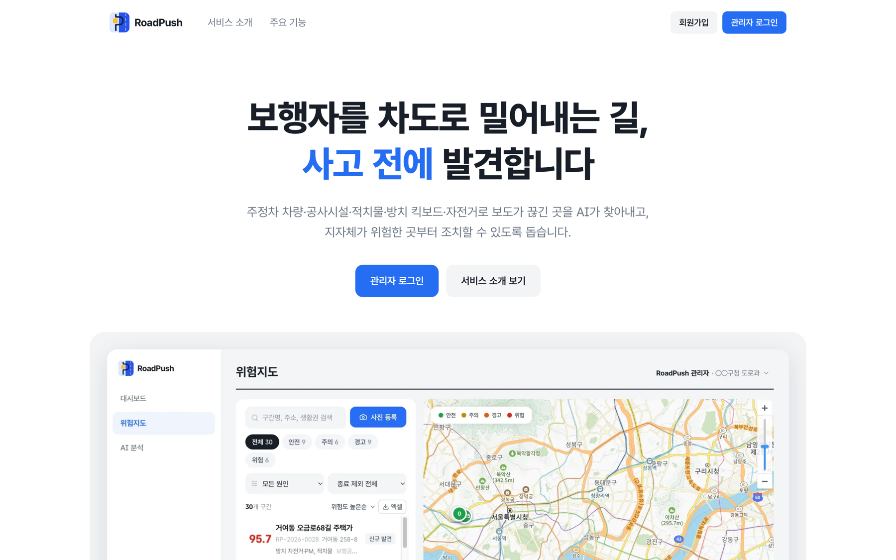
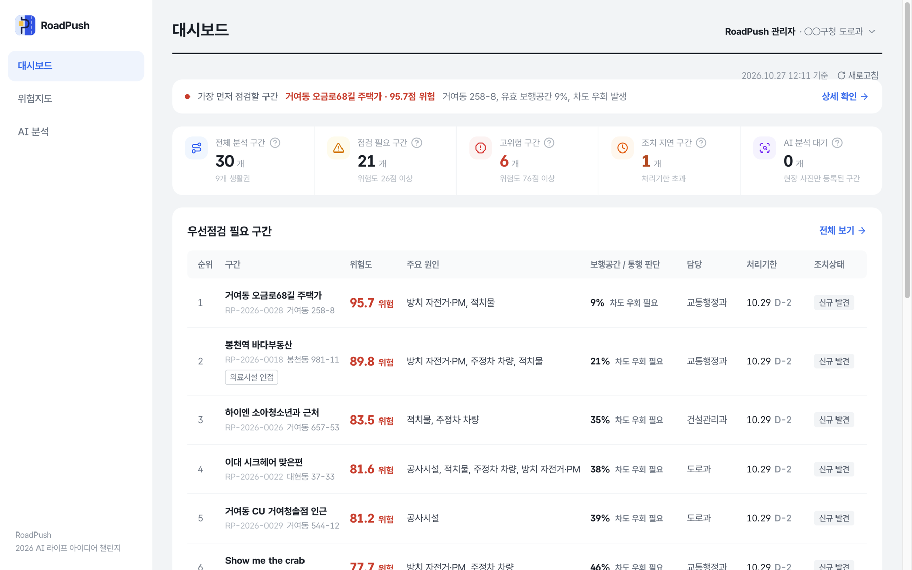
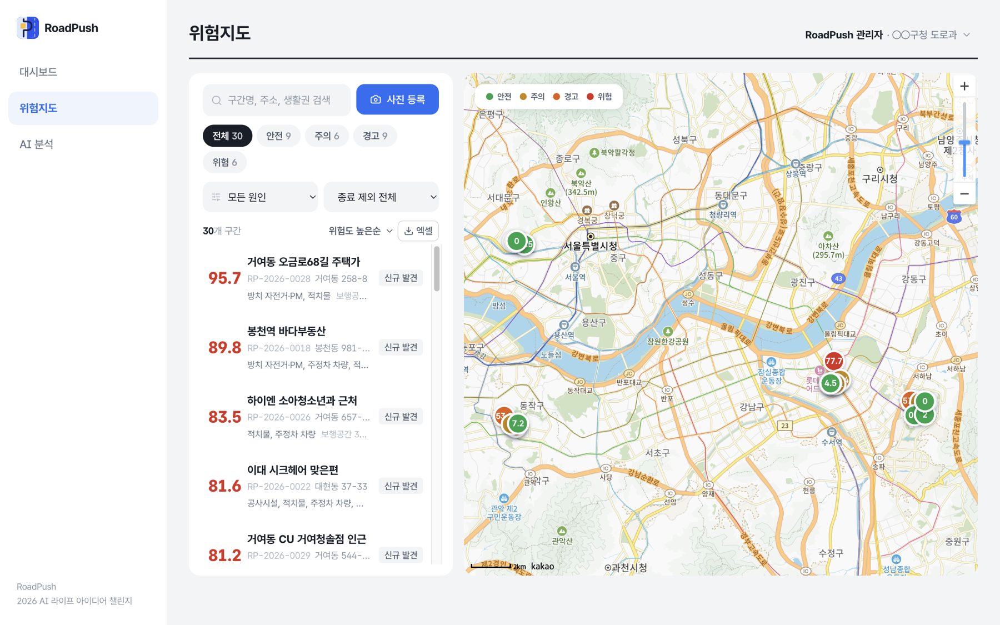
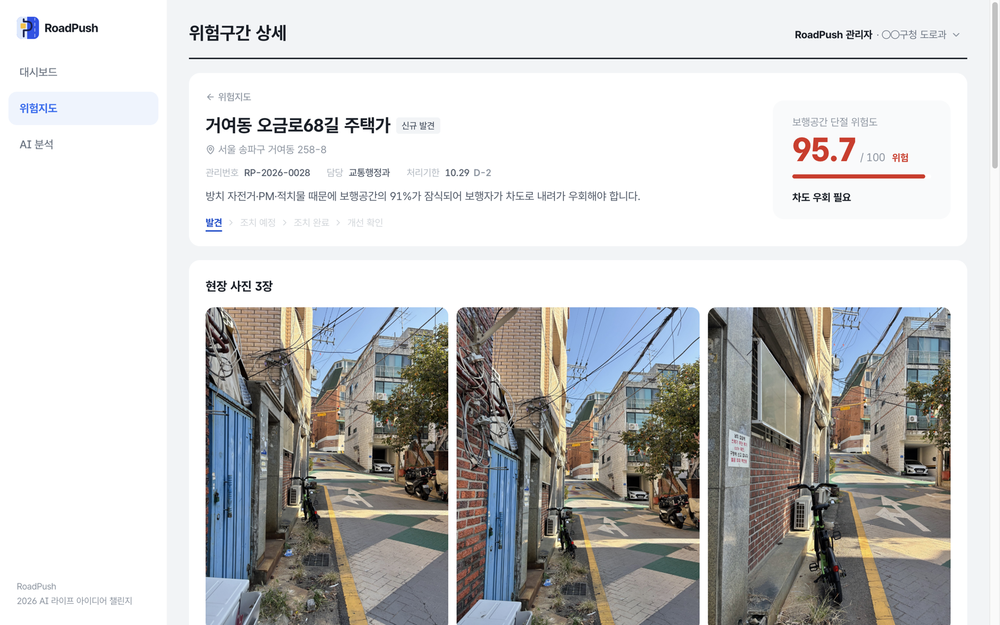
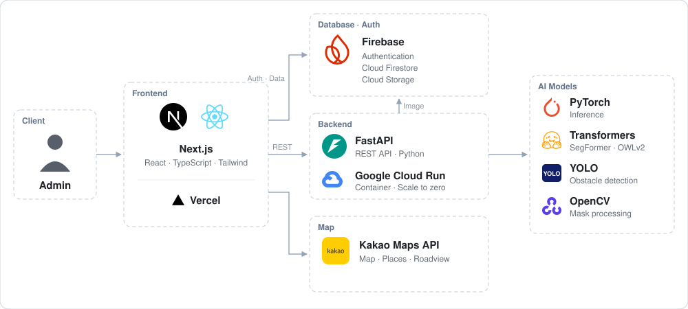

# 🚶 RoadPush

> 보행자를 차도로 밀어내는 길을 AI로 찾아내는 **보행공간 단절 관리 서비스**입니다.

<p align="center"></p>

RoadPush는 도로 사진·영상을 **AI로 분석해 보행공간이 끊긴 구간을 찾고**, 위험도를 지도에 표시한 뒤 **관리자가 조치하고 개선을 확인할 때까지** 이어서 관리하는 서비스입니다.

무엇이 놓여 있는지가 아니라, **보행자가 계속 걸을 수 있는 공간이 남아 있는지**를 판단합니다.

🔗 **서비스 바로가기** : https://road-push.vercel.app

---

## 💡 1. Overview

### 1-1. 프로젝트 소개

- **프로젝트 명** : RoadPush, 보행자를 '차도로 밀어내는 길' AI 자동탐지
- **프로젝트 정의** : CCTV·블랙박스·현장점검 영상에서 보행공간이 끊긴 구간을 AI로 찾아 위험도를 매기고, 지자체 담당자가 우선점검·현장조치·개선 확인까지 관리하도록 돕는 지도 기반 관리 서비스입니다.
- **출품** : 2026 AI 라이프 아이디어 챌린지

### 1-2. 개발 배경 및 필요성

불법 주정차, 공사 자재, 가게 적치물, 방치된 자전거·PM이 보도를 막으면 보행자는 차도로 내려가 걸어야 합니다.
특히 보도와 차도가 나뉘지 않은 골목이나 좁은 보도에서는 작은 적치물 하나로도 길이 끊기게 됩니다.

하지만 이런 **보행공간 단절**은 사고나 민원이 생기기 전까지 관리 대상으로 잡히지 않는 것이 현실입니다.
담당자가 모든 길을 직접 돌아보기 어렵고, 장애물이 있다는 사실만으로는 실제로 걸을 수 없을 만큼 막혔는지 판단하기도 어렵기 때문입니다.

RoadPush는 이미 있는 도로 영상을 활용해 **사고 전에 위험 신호를 먼저 찾고**, 어디부터 조치해야 하는지 우선순위를 제시합니다.

### 1-3. 프로젝트 특장점

- **장애물이 아닌 보행공간을 판단** : 장애물 개수 대신 걸을 수 있는 길이 얼마나 남았는지, 차도로 내려가야 하는지를 판단합니다.
- **발견에서 개선 확인까지** : 발견 → 판단 → 조치 → 개선 확인을 한 화면에서 이어서 관리합니다.

### 1-4. 주요 기능

- **AI 보행공간 분석** : 사진·영상에서 보도·차도와 장애물을 인식하고 위험도와 판단 근거를 제공합니다.
- **대시보드** : 점검 필요·고위험·조치 지연 구간과 우선점검 목록을 한눈에 보여줍니다.
- **위험지도** : 카카오맵 위에 구간별 위험도를 색으로 표시하고 원인·조치 상태별로 걸러봅니다.
- **구간 상세** : 분석 결과 비교, 주변 시설, 로드뷰, 같은 위치의 발생 이력을 제공합니다.
- **현장조치 관리** : 담당 부서·처리기한을 지정하고 조치 상태와 이력을 기록합니다.
- **개선 확인** : 조치 후 재분석으로 조치 전후 위험도를 비교합니다.

<p align="center">
  
  
  
</p>

### 1-5. 기대 효과

- 사고·민원 전에 보행 위험 구간을 찾아 먼저 조치할 수 있습니다.
- 위험도와 원인을 근거로 점검 우선순위를 정해 한정된 인력을 효율적으로 활용합니다.
- 어린이보호구역·지하철역 주변 보행 안전 관리와 지도·내비게이션 연계로 확장할 수 있습니다.

---

## 💡 2. Team

<table>
  <tr>
    <td align="center" width="25%"><b>김예원</b></td>
    <td align="center" width="25%"><b>구지원</b></td>
    <td align="center" width="25%"><b>손시영</b></td>
    <td align="center" width="25%"><b>이윤진</b></td>
  </tr>
  <tr>
    <td align="center"><b>Data · Report</b></td>
    <td align="center"><b>Frontend</b></td>
    <td align="center"><b>AI · Backend</b></td>
    <td align="center"><b>Data · Report</b></td>
  </tr>
  <tr>
    <td align="center">• 데이터 수집<br>• 보고서 작성</td>
    <td align="center">• 웹 개발 · 배포<br>• DB · 지도 연동</td>
    <td align="center">• AI 모델 개발<br>• 분석 서버 구축</td>
    <td align="center">• 현장 사진 촬영<br>• 보고서 작성</td>
  </tr>
</table>

---

## 💡 3. Tech Stack

| 구분 | 기술 |
| :--- | :--- |
| **Frontend** |     |
| **Map** |  |
| **Backend** |   |
| **AI** |     |
| **Database · Auth** |  |
| **Deploy** |   |

---

## 💡 4. System Architecture

### 4-1. 전체 구성도

<p align="center">
  
</p>

관리자가 웹에서 사진을 올리면 분석 서버가 AI로 보행공간을 판단해 결과를 돌려줍니다.
웹은 결과를 Firestore에 기록하고 지도·대시보드에 표시합니다.

### 4-2. Frontend

지자체·도로관리기관 담당자가 사용하는 관리 화면입니다.

- 분석 결과와 조치 이력은 Firestore 보안 규칙으로 **추가만 허용**해 기록이 바뀌지 않도록 합니다.
- 카카오 장소 검색으로 주변 지하철역·어린이보호구역·의료시설을 찾아 우선순위 판단에 활용합니다.

### 4-3. Backend

사진·영상을 받아 AI로 분석하고 위험도와 탐지 결과를 돌려주는 서버입니다.

- `POST /api/v1/analyze` 로 이미지·영상 또는 등록된 현장 사진을 받아 분석합니다. 영상은 가장 위험한 장면을 대표로 사용합니다.
- 얼굴·차량번호판이 찍힐 수 있어 **받은 사진은 서버에 저장하지 않습니다.**

### 4-4. 폴더 구조

```
RoadPush/
├── frontend/                       관리자 웹 (Next.js)
│   └── src/
│       ├── app/(admin)/
│       │   ├── dashboard/          대시보드
│       │   ├── map/                위험지도 · 현장 사진 등록 · 일괄 분석
│       │   ├── analysis/           AI 분석 (사진·영상 업로드)
│       │   └── locations/[id]/     구간 상세 · 현장조치 · 재분석
│       ├── components/             화면 구성 요소 (지도, 위험도, 분석 결과, 조치 관리)
│       ├── services/               외부 연동 (Firebase, AI 분석 서버)
│       ├── constants/risk.ts       위험도 단계 · 장애물 유형 기준
│       └── lib/                    처리기한 · 발생 이력 · 엑셀 내보내기 등 공통 로직
├── backend/
│   └── app/main.py                 분석 API (FastAPI)
├── ai/
│   ├── roadpush_score.py           보도 인식 · 장애물 탐지 · 위험도 계산
│   ├── roadpush_engine.py          분석 결과를 웹 응답 형식으로 변환
│   ├── roadpush_eval.py            현장판정과 AI 결과 비교 평가
│   ├── train_yolo.py               장애물 탐지 모델(YOLO) 학습
│   ├── train_surface.py            보도·차도 구분 모델 학습
│   └── config.json                 모델 · 판단 기준 설정
├── firestore.rules                 데이터 보안 규칙 (분석·조치 기록 수정 방지)
└── storage.rules                   사진 저장소 보안 규칙
```

---

## 💡 5. AI Analysis

### 5-1. 분석 과정

**보도 구분 → 장애물 탐지 → 공간 판단 → 위험도 산출**

| 단계 | 모델 · 방법 | 설명 |
|---|---|---|
| 보도 구분 | SegFormer | 보도·차도 분리, 초록 보행 포장 포함 |
| 장애물 탐지 | YOLO + OWLv2 | 차량·공사시설·적치물·자전거·PM 탐지 |
| 공간 판단 | 영역 계산 | 막힌 비율·연속성·최소 폭 계산 |
| 위험도 산출 | 가중 합산 | 잠식·단절·차도 이탈 합산 후 4단계 구분 |

| 위험도 | 의미 |
|:---:|---|
| 🟢 **안전** | 보행 원활 |
| 🟡 **주의** | 보행공간 일부 잠식 |
| 🟠 **경고** | 보행공간 상당 부분 잠식 |
| 🔴 **위험** | 차도 우회 위험 |

현장 사진의 사람 판정과 AI 결과를 비교해 판단 기준을 보정함

### 5-2. 핵심 소스코드 : 위험도 계산

```python
walkable_ratio = float(remain.sum()) / n_orig          # 보행공간 중 남은 비율
departure = (vcov < cfg["vcov_min"]) or (choke < cfg["choke_min"])  # 차도 이탈 여부

erosion = 100.0 * (1.0 - walkable_ratio)               # 공간 잠식
disconnect = 100.0 * max(1.0 - vcov, 1.0 - min(1.0, choke / cfg["choke_ok"]))  # 단절
risk = (
    w_["erosion"] * erosion
    + w_["disconnect"] * disconnect
    + w_["departure"] * (100.0 if departure else 0.0)
)
```

남은 보행공간 비율로 **공간 잠식**을 계산하고, 남은 길이 세로로 이어지는 정도(`vcov`)와 가장 좁은 구간의 폭(`choke`)으로 **단절**을 계산합니다.
길이 끊기거나 너무 좁아지면 보행자가 차도로 내려가야 하는 **차도 이탈**로 판단하고, 세 값을 가중 합산해 위험도를 산출합니다.

---

## 💡 6. Why This Stack

| 기술 | 선택 이유 |
|---|---|
| **SegFormer** | 보도·차도를 바로 구분, CPU 서버에서도 동작함 |
| **YOLO** | AI Hub 데이터로 학습해 주요 장애물을 빠르게 탐지함 |
| **OWLv2** | 학습하지 않은 적치물도 텍스트로 탐지함 |
| **FastAPI** | Python AI 코드를 그대로 API로 제공함 |
| **Google Cloud Run** | 요청이 있을 때만 실행되어 비용이 적음 |
| **Next.js** | 관리 화면 구성과 Vercel 배포가 간편함 |
| **Firebase** | 로그인·데이터·사진 저장을 서버 없이 처리함 |
| **Kakao Maps** | 국내 장소 검색과 로드뷰로 현장 확인이 쉬움 |

---

## 💡 7. Getting Started

설치 없이 웹에서 바로 사용할 수 있습니다.

1. **https://road-push.vercel.app** 에 접속합니다.
2. 회원가입 후 로그인합니다.
3. **대시보드**에서 우선점검 구간을 확인하고, **위험지도**에서 지역별 현황을 확인합니다.
4. **AI 분석**에서 도로 사진이나 영상을 올려 위험도를 확인합니다.
5. 구간 상세에서 조치 상태를 변경하고, 조치 후 사진으로 재분석해 개선 여부를 확인합니다.

<details>
<summary>로컬에서 실행하기</summary>

```bash
cd frontend
cp .env.example .env.local   # Firebase, 카카오맵 키, 분석 서버 주소 입력
npm install
npm run dev                  # http://localhost:3000
```

분석 서버 주소(`NEXT_PUBLIC_API_BASE_URL`)가 비어 있으면 예시 분석으로 화면을 확인할 수 있습니다.

</details>
